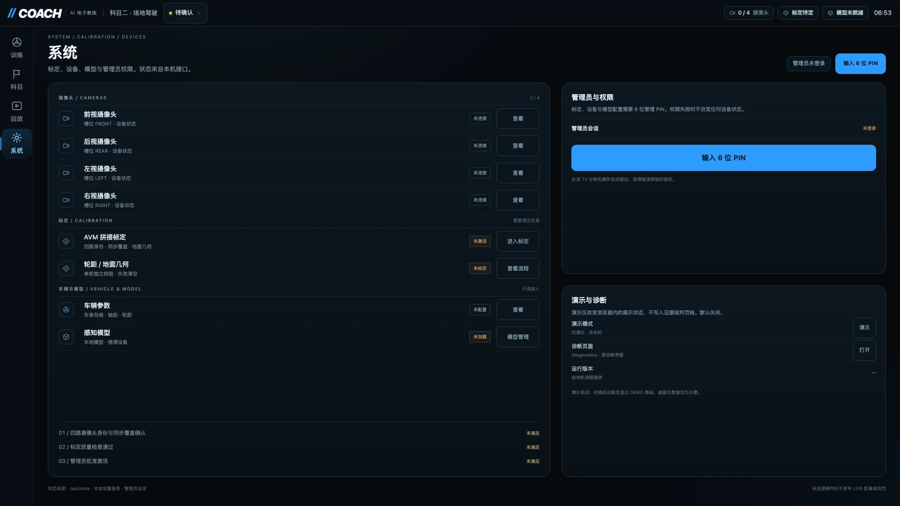

# COACH · AI 视觉电子教练

**让学员看懂车轮与标线的关系，让教练更容易讲清每一次操作。**

面向驾校科目二低速训练的本地视觉辅助系统 · 产品展示与网页模拟体验

**[在线体验驾驶模拟器](https://coach-driving-simulator-n006zm19eq8.qoder.zone/)** · **[查看产品界面](#产品界面)** · **[合作联系](#合作联系)**

**微信：`pathetichomeless`**

欢迎驾校、教练、车载硬件团队交流训练需求与试点合作。添加时请备注「COACH」。

> 上图为界面 DEMO，非实车感知结果。COACH 正式主程序与网页模拟器相互独立；本仓库只公开介绍、展示图片和体验链接。

## 在线体验

无需安装，通过浏览器体验科目二虚拟训练场。

**[打开 COACH 科目二全场驾驶模拟器](https://coach-driving-simulator-n006zm19eq8.qoder.zone/)**

| 体验内容 | 可以看到什么 |
| --- | --- |
| 自由驾驶 | 在完整虚拟场地中行驶，自行进入训练区域 |
| 专项训练 | 倒车入库、侧方停车、坡道定点停车与起步、直角转弯、曲线行驶 |
| 模拟考试 | 按顺序完成五项训练，查看仿真事件与用时 |
| 多视角观察 | 驾驶员、第三人称、鸟瞰和车辆四向视角；驾驶员后视镜与倒车辅助 |
| 操作与复盘 | 简单／真实操作模式、D/N/R 换挡、四轮几何距离、事件与轨迹回放 |

桌面可使用页面提示的键盘操作；手机提供触控方向、挡位及踏板。首次体验可先选择「自由驾驶」与「简单」模式。

查看手机触控界面

模拟器中的距离由虚拟场景几何计算，不是摄像头 AI 识别结果。场地、教学规则与评分仅用于仿真展示，不代表官方考试标准，也不代替实际驾驶训练。

## COACH 想解决什么

倒车影像能看到黄线，但学员往往仍难判断「哪个轮子最接近」「该看哪里」「为什么这次操作出了问题」。COACH 将视觉、车辆几何与训练反馈放在同一界面，帮助教练解释动作，帮助学员理解空间关系。

| 方向 | 产品设计与当前边界 |
| --- | --- |
| 黄色标线与轮线关系 | 已有视觉模型和车辆几何软件链路；实际精度依赖最终安装、标定及场地验证 |
| 多摄与环视 | 已有相机输入、角色校验、AVM 与界面基础；真实四摄同步及覆盖待验收 |
| 状态可信可见 | 输入、标定或观测不足时显示 UNKNOWN，不编造距离和车辆状态 |
| 教学与复盘 | 提供训练界面、事件录像与复盘软件基础；真实教学及判罚须单独实测批准 |
| 本地优先 | 正式主程序在 Ubuntu 本地运行；车载 RK3588 移植与整机验证待硬件阶段完成 |

## 产品界面

以下为 UI 2.0 软件展示截图，采用无硬件／演示状态，不是实车就绪证明。

| 科目入口 | 系统与设备管理 |
| --- | --- |
|  |  |

查看无摄像头输入时的安全状态

摄像头未就绪、未批准的实测车辆配置或标定不足时，保留 UNKNOWN／HOLD，距离不可用。

## 当前阶段

已完成 Ubuntu 软件集成、界面与仿真验证。当前仍需最终四摄安装、实测车辆几何与相机标定、RK3588 板端验证，以及封闭场地实车测试。真实测距、连续压线／越线精度和五科实车教学闭环仍须分别验收。

软件与模拟器展示不构成实车性能承诺；驾驶操作与现场安全由驾驶员及教练负责。

## 合作联系

**微信：`pathetichomeless`**

欢迎交流：

- 驾校与教练：训练痛点、界面反馈、后续封闭场地验证需求。
- 车载硬件团队：RK3588、四摄、触控屏与安装适配。
- 行业合作伙伴：产品演示与试点方案，具体范围沟通确认。

添加微信请备注 **「COACH + 所在城市／合作方向」**。

## 展示资料说明

本仓库不提供正式主程序或模拟器的源码、模型权重、现场配置、学员档案或运行数据。在线模拟体验由独立站点提供。

截图中的第三方车辆模型署名与来源见 [CREDITS.md](CREDITS.md)。

---

**COACH · AI Vision-Based Driving Training Assistant**

产品展示更新：2026-11-25
