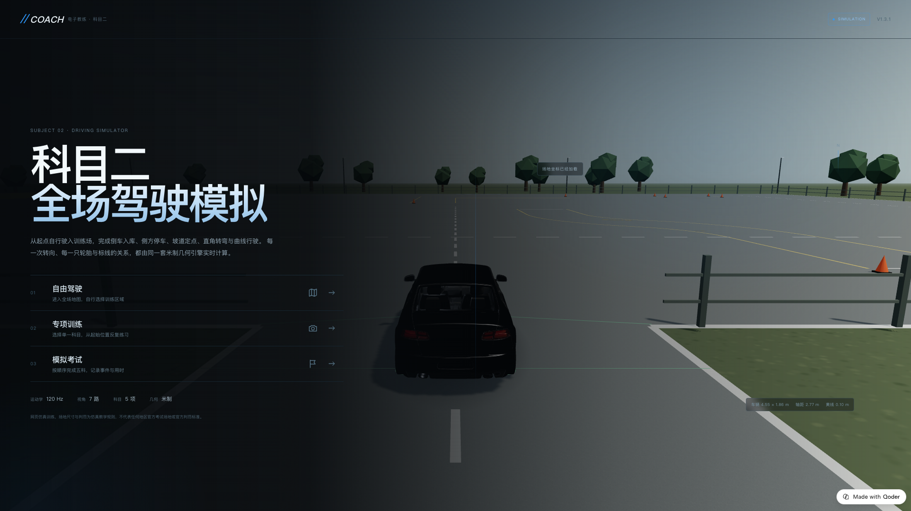
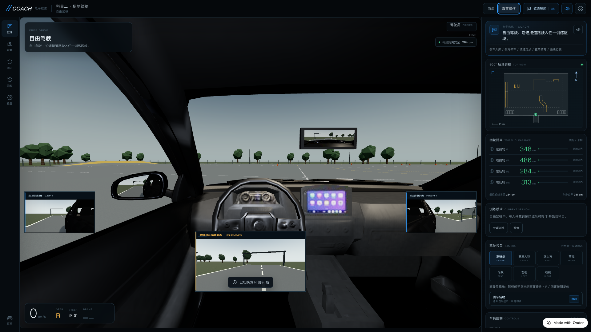
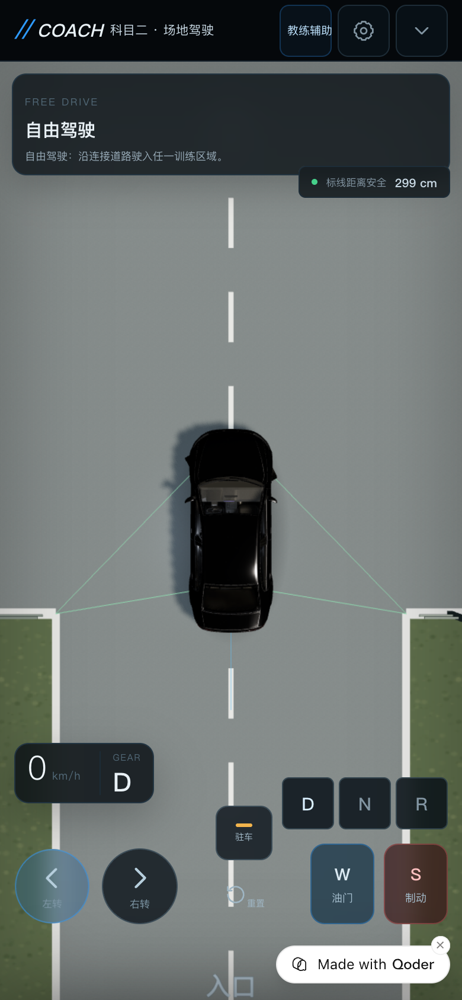
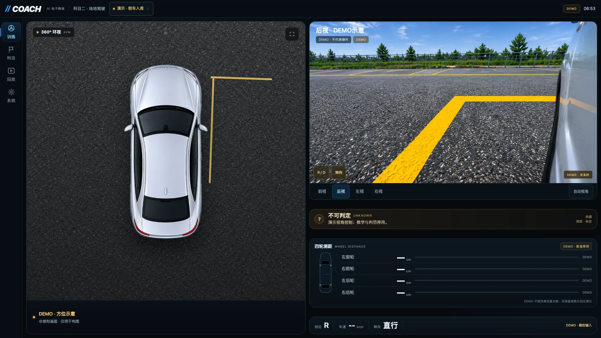
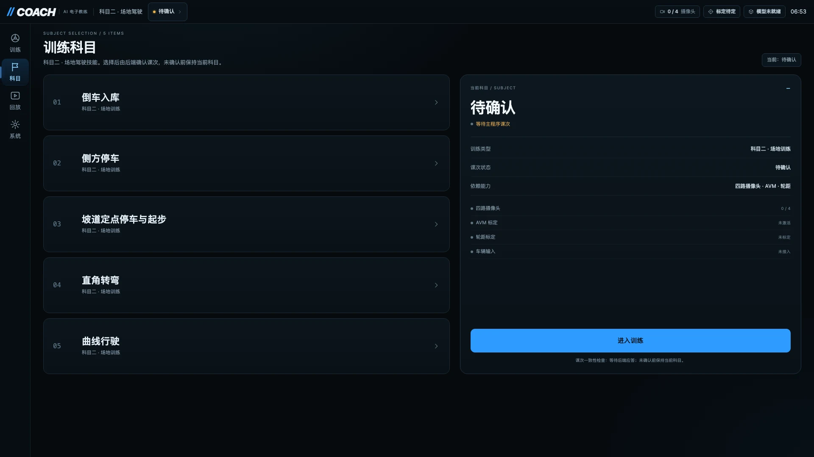
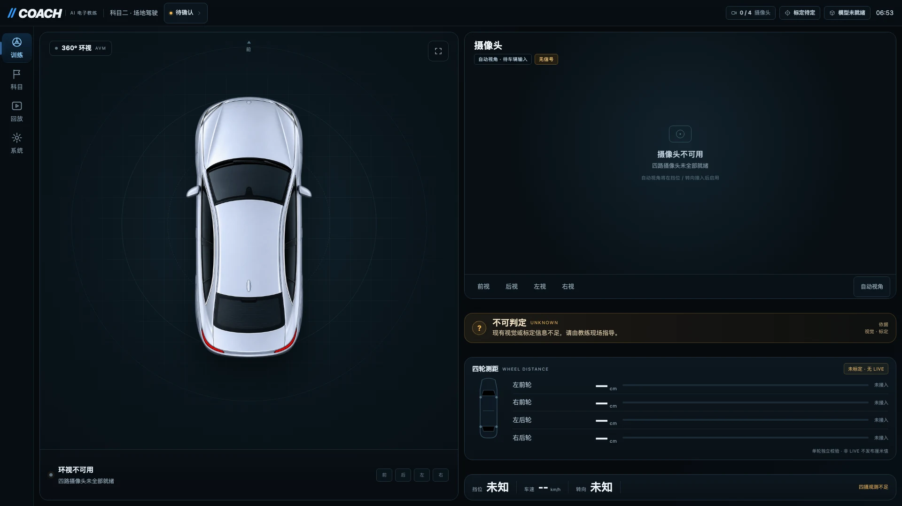

# COACH · Visual Driver Coaching

**Practise parking and reversing with wheel-clearance feedback, mirrors and replay.**

A browser driving simulator and an experimental, local-first visual coaching project.

**[Try the simulator](https://coach-driving-simulator-n006zm19eq8.qoder.zone/)** · **[Quick start](#quick-start)** · **[Product gallery](#product-gallery)** · **[Contact](#contact)** · **[中文](README.zh-CN.md)**

**Email: [pathetichomeless@gmail.com](mailto:pathetichomeless@gmail.com)**

## Try it in your browser

Explore a virtual training area, practise manoeuvres and see how the wheels relate to nearby markings. The simulator includes free driving, focused exercises, simulated assessment, mirrors, several camera views and recorded simulation replay.

**[Open the COACH driving simulator](https://coach-driving-simulator-n006zm19eq8.qoder.zone/)**

The current demo interface is **in Chinese**. The guide below will help you get started. The demo is a simulation: its distances come from virtual geometry, independently of the real-camera AI pipeline.

## Quick start

1. Choose **自由驾驶 — Free driving** on the opening screen.
2. Use **简单 — Simplified controls** for a first look. Follow the on-screen keyboard or touch-control instructions.
3. Try the driver's view and mirrors, or switch to the bird's-eye view to inspect wheel positions.
4. Open the coaching panel to see simulated wheel clearances and replay your driving session.

| Chinese label | Meaning |
| --- | --- |
| 自由驾驶 | Free driving |
| 专项训练 | Manoeuvre practice |
| 模拟考试 | Simulated assessment |
| 简单 / 真实操作 | Simplified / detailed controls |
| 驾驶员 / 第三人称 / 正上方 | Driver's / chase / bird's-eye view |
| 教练辅助 | Coaching panel |
| 轨迹回放 | Simulation replay |
| D / N / R | Drive / neutral / reverse |

The virtual exercises cover reverse parking, parallel parking, hill starts, right-angle turns and curved paths. Layouts and assessment rules are illustrative, rather than a certified driving test for any jurisdiction.

Mobile touch controls

## Why this project exists

Learners often need help understanding which wheel is closest to a marking, what to watch while reversing and how a steering input changes the vehicle's position. COACH explores clearer visual feedback for instructors and learners during low-speed practice.

The broader project combines a local-first Ubuntu application, yellow-marking perception, vehicle geometry and training-review software. The browser simulator offers a separate way to explore the spatial-coaching idea.

## Product gallery

The Ubuntu UI 2.0 screenshots below show demonstration or no-camera states. They illustrate the interface rather than real-vehicle performance.

| Training subjects | System and calibration management |
| --- | --- |
|  |  |

No-camera state

Missing cameras, approved calibration or trustworthy observations keep measurement and teaching unavailable. The application retains UNKNOWN/HOLD rather than inventing a distance.

## Current stage

Software integration and simulation checks have been completed. Physical four-camera installation, measured vehicle geometry, approved calibration, RK3588 deployment and controlled real-vehicle validation remain to be completed.

The current visual-perception work focuses on yellow training markings. Other marking colours, local training rules and English software localisation require separate assessment. The simulator is not an official driving examination or a substitute for supervised real-world training.

## Feedback and collaboration

We would like to hear from:

- **Instructors and learners:** which views or explanations help you understand wheel position during parking?
- **Training organisations:** which low-speed manoeuvres are hardest to explain and review?
- **Hardware and simulation teams:** which local training or installation requirements would a future pilot need to address?

Specific feedback from trying the demo is welcome. Any future physical pilot would need its own agreed scope and validation.

## Contact

**Email: [pathetichomeless@gmail.com](mailto:pathetichomeless@gmail.com)**

Optional WeChat: `pathetichomeless`

Please mention **COACH** and your organisation or area of interest.

## About this repository

This is a public product showcase containing screenshots, documentation and demo links. The main-program and simulator source code, model weights, operational data and student records are not distributed here.

Vehicle-model attribution and screenshot sources are preserved in [CREDITS.md](CREDITS.md).

---

COACH · AI Vision-Based Driving Training Assistant · Updated 25 November 2026
